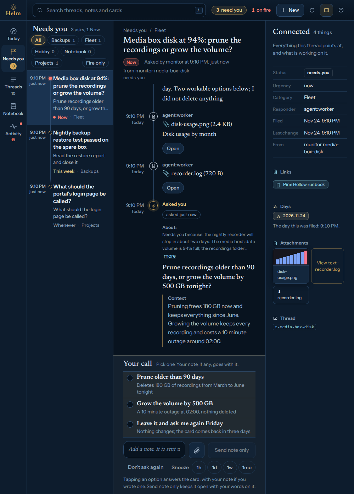
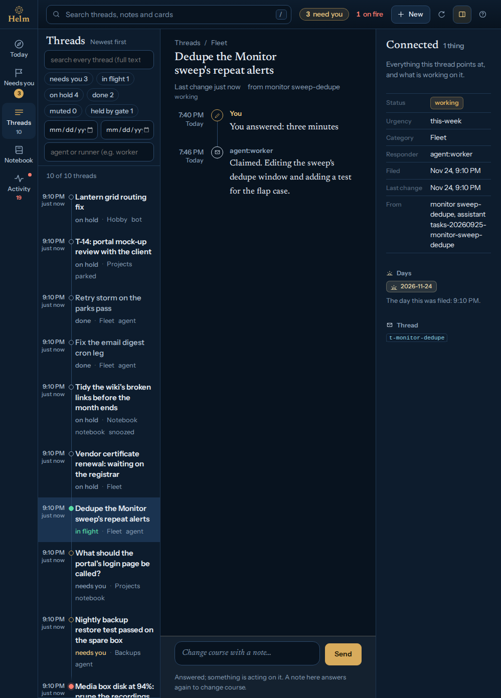
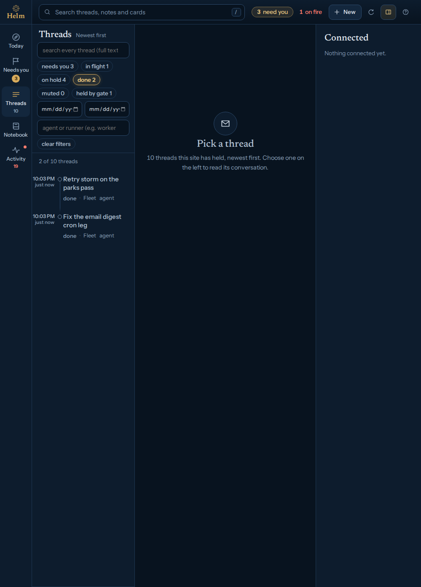
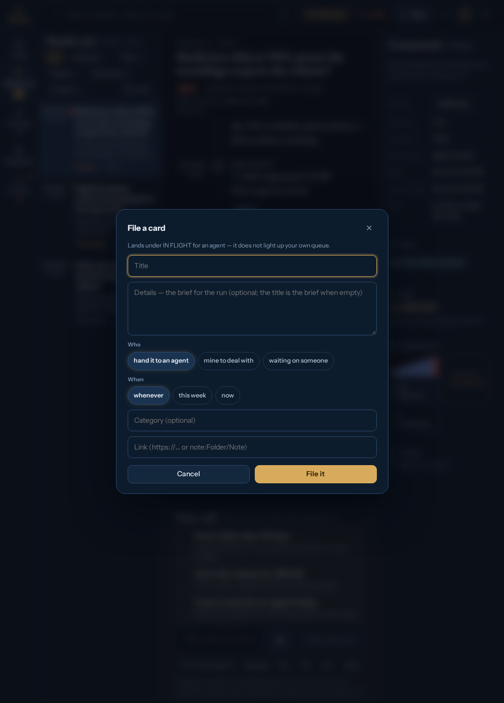
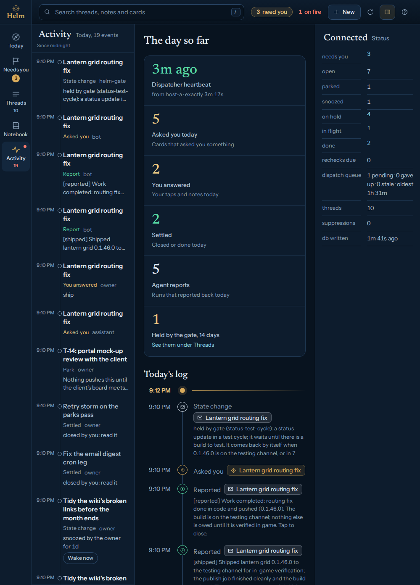

# Helm

An inbox for the things only you can do.

Work arrives as **cards**. A card that needs a person carries the question, its context and the
options, with the consequence of each option written on it. You tap one; the work carries on.
Everything else — an agent's report, a wait, a close — stays in the same conversation, so the task
and its answer are one thread you can read later.



## What it does

- **One call files a card.** `PUT /api/triage/threads` with a bearer token, from any script, cron
  job or agent. There is no console to learn: the payload carries the ask.
- **The quality gate.** A card reaches a person only if it passes four tests: the next step needs
  something only they can do, the ask is still true, they do not already know, and no agent can fix
  it. Cards that fail are held, with the reason.
- **Ask shapes.** A choice with options and their effects, a plain question, or an acknowledgment
  ("read the report and close it"). A text ask must end in a question mark; a choice ask needs at
  least two options that read on their own.
- **Answers come back.** `POST /api/triage/threads/{id}/reply` — the tap is the record, and the
  producer reads the answer off the thread.
- **A notebook.** A folder of markdown notes, indexed and searchable, with a day view that ties
  the day's pages to the day's threads. Read-only, or store mode where Helm owns its own copies.
- **Activity.** Heartbeat, today's counts, every event, and what the runs cost.
- **A phone web app.** One page: three panes on a desktop, a stack on a phone. Installable, and it
  keeps what you typed while the network is slow.
- **Per-caller tokens.** `python3 -m helm.tokens add <principal>` mints a token per producer,
  so a reply is
  recorded as whoever made it.
- **Forward-auth SSO.** Helm believes a login header (`X-Forwarded-User` by default) only from the
  addresses you name, so any authenticating proxy — Traefik, Caddy, nginx + oauth2-proxy,
  Authelia, Authentik — can sit in front of it.
- **Prometheus metrics.** `GET /metrics`.

|  |  |
|---|---|
|  |  |
|  |  |

More shots, at a desktop size and a phone size, are in [docs/screens](docs/screens/).

## Running it

Docker on Linux, on a machine of your own. Two roles come up — the API (the store) and the web role
(the screens and the same-origin proxy) — and a dev login stands in for the proxy, so both bind
loopback only and nothing is exposed. The quick start uses host networking for the web role so it can
bind loopback; on Docker Desktop for macOS or Windows, turn host networking on, or run the production
shape in `deploy/compose.yml` behind a proxy instead.

Clone the repository, then from its root:

```sh
cp .env.example .env
sed -i "s/^HELM_APP_TOKEN=.*/HELM_APP_TOKEN=$(openssl rand -hex 32)/" .env
docker compose up -d --build
```

Open <http://127.0.0.1:3037>. It is empty: nothing has filed a card yet.

File one the way a producer would, over the API role:

```sh
TOKEN=$(grep '^HELM_APP_TOKEN=' .env | cut -d= -f2 | tail -n1)
curl -sS -X PUT http://127.0.0.1:3038/api/triage/threads \
  -H "Authorization: Bearer $TOKEN" -H 'Content-Type: application/json' \
  -d '{
    "threads": [{
      "thread_id": "disk-space",
      "title": "Backup volume at 94%",
      "summary": "Needs you because: the nightly backup stops in about two days.",
      "category": "Backups", "urgency": "now", "state": "needs-you",
      "ask": {
        "kind": "choice",
        "subject": "Free space on the backup volume",
        "recap": "The volume is 94% full and keeps about two days of room.",
        "prompt": "Prune the archives, or grow the volume?",
        "context": "Pruning frees 180 GB tonight and keeps everything since June. Growing keeps every archive and costs a ten-minute outage.",
        "requires": ["decision"],
        "options": [
          {"label": "Prune older than 90 days", "value": "prune", "effect": "Deletes 180 GB of archives tonight"},
          {"label": "Grow the volume by 500 GB", "value": "grow", "effect": "A ten-minute outage tonight, nothing deleted"}
        ]
      },
      "sources": [{"source": "monitor", "id": "backup-volume"}]
    }]
  }'
```

Refresh the browser: the card is under **Needs you**, with its question and both options. Tap one,
then read the answer back:

```sh
curl -sS http://127.0.0.1:3038/api/triage/threads/disk-space \
  -H "Authorization: Bearer $TOKEN" | python3 -m json.tool | head -20
```

The state is `working` and the answer is on the thread's events. Producers on your own machine talk
to the API role the same way.

## Getting the most out of it

- Put your markdown in `./notes` before the first `docker compose up`, and the notebook shows it.
- `docs/SETUP.md` — tokens, the proxy, notes modes, backups, every environment variable.
- `docs/API.md` — the routes the producers use.
- `docs/ARCHITECTURE.md` — how the two roles fit together.
- `deploy/compose.yml` — the production shape: a proxy in front of the web role, nothing published
  to the network. Run it from `deploy/`, so its `.env` and its `./notes` beside the file are the ones
  it reads.

## How this was built

Helm was designed, specified and accepted by its author and implemented by AI coding agents
(Claude Code and others). Every change went through the same rails: a failing test first for each
bug, CI on every change, and an independent AI review that is never the change's author before it
merges. This repository is a public snapshot of a private development history, so it carries only a
few commits.

The Android client is not included here. On a phone, use the installable web app described above.

## Tests

```sh
pip install -r requirements-dev.txt
python3 -m playwright install --with-deps chromium
python3 tests/run_all.py            # every suite, one exit code
```

`tests/run_all.py` runs each suite in its own process. The browser suites drive a real deployment
on loopback, brought up from synthetic data by `tools/screens/fixture.py`.

## Layout

| Path | What it is |
|---|---|
| `app/service.py` | the API role: the triage routes, auth, the gate |
| `app/web.py` | the web role: the static screens and the same-origin API proxy |
| `helm/store.py` | the store: threads, asks, events, the SQLite schema |
| `helm/gate_rules.py`, `helm/card_rules.py` | the quality gate and the card-shape rules |
| `notebook/` | the markdown note store, its index, the day view and the topic hub |
| `web/` | the front end (plain ES modules, no build step) |
| `deploy/` | the image, the entrypoint and the production compose file |
| `tools/screens/` | the synthetic-data fixture and the screenshot rig |
| `tests/` | the suites, one file per area |

## License

MIT. See [LICENSE](LICENSE).
